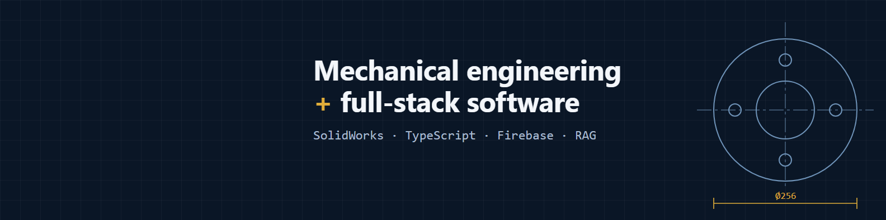

# Antonio Joab Garibay

Mechanical engineer and full-stack developer in Mexico. I spent about four years designing industrial structures and machinery in SolidWorks. In 2025 I moved to freelance work on automations and websites, and since January 2026 I've built and run web applications in production.

I'm open to remote contract work, including AI evaluation on mechanical engineering, CAD and software problems.

## What I work with

| Area | Tools |
|---|---|
| Mechanical | SolidWorks, sheet metal, structures, Flow Simulation, Autodesk Inventor, technical drawings, bills of materials |
| Frontend | TypeScript, Angular, React, PWA |
| Backend | Node.js, Firebase (Firestore, Auth, Storage, Cloud Functions), Stripe |
| AI | RAG, Qdrant, n8n, prompt injection defense, coding agents |
| Operations | Linux, Docker, GitHub Actions, Playwright |

## Public work

- [engineering-notes](https://github.com/MrChinoo/engineering-notes): what broke in production, how I found it, and what changed
- [firestore-rules-probe](https://github.com/MrChinoo/firestore-rules-probe): test deployed Firestore rules against the live API
- [gcf-fleet-doctor](https://github.com/MrChinoo/gcf-fleet-doctor): check and recover Cloud Functions across projects
- [npm-audit-exceptions](https://github.com/MrChinoo/npm-audit-exceptions): strict npm audit with exceptions that expire
- [Koyo kiosk demo](https://cafeteria.joabgaribay.com): self-service kiosk for a fictional cafe ([source](https://github.com/MrChinoo/Koncafe_revamp))

Most of my client work lives in private repositories. Live demos are at [joabgaribay.com/demos](https://joabgaribay.com/demos), and I can walk through the architecture in an interview.

## Contact

[LinkedIn](https://www.linkedin.com/in/joab-garibay) · [Portfolio](https://joabgaribay.com/perfil)
